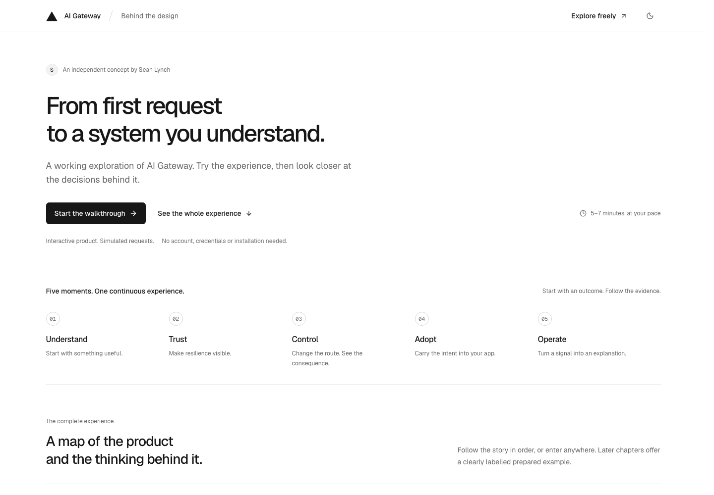

# AI Gateway: a connected experience

**An independent design and engineering concept by Sean Lynch.**

From a first useful request to a system you understand: discover models, see a provider recover, shape a route, compare the consequence, and carry that configuration into your own application.

[Start the walkthrough](https://sean-ai-gateway-concept.vercel.app/review) · [Explore the product](https://sean-ai-gateway-concept.vercel.app/) · [Read the one-page overview](docs/Sean_Lynch_AI_Gateway_Overview.pdf)



## Start here

The guided walkthrough takes roughly 5–7 minutes through **Understand → Trust → Control → Adopt → Operate**. Each chapter pairs a working interaction with optional commentary about user goals, product opportunities, design decisions, tradeoffs and further validation. A full product map lets you explore independently.

Try the connected path:

1. Run a prepared support request, then introduce a provider failure.
2. Inspect recovery through the same request's attempts, timing and outcome.
3. Reorder providers directly or with the keyboard. Compare Original and Draft using the same workload and pinned conditions.
4. Review and activate a simulated revision, then verify it with another request.
5. Prepare an editor brief or download a starter. Follow the request into the operational workspace.

## The design proposition

Gateway combines model access, routing and observability. I explored how people could understand those relationships through use, while retaining precise control as their needs become more complex.

The route is a working instrument: preferences, eligible providers, exclusions and conditional model fallback stay distinct. Evidence remains attached to the request that produced it. Choices travel between exploration, configuration and integration rather than restarting at each page.

The visual language uses Geist, neutral surfaces, shared content edges and progressive disclosure. Motion responds to actions. Details expand within the page, with equivalent keyboard controls, reduced-motion behavior and light and dark themes.

## What is real, and what is simulated?

This is an account-free prototype. Requests, responses, operational metrics, outages, route activation and credential-management records are simulated and stored in the browser. The model catalog is a curated snapshot, not live provider health or performance data. The concept collects no credentials and makes no live Gateway calls.

Editor links prepare a reviewable integration prompt. The downloadable starter contains application source and server-side authentication instructions; real execution and credentials belong in the visitor's own environment. Copying instructions or opening an editor never proves installation or connection. The walkthrough keeps a separate browser-local profile from ordinary exploration.

This is independent work, unaffiliated with Vercel. It demonstrates behavior and design judgment; it does not claim measured usability or production improvements.

## Run locally

Use Node.js 24 and pnpm 10.30.3. No environment variables, account or API key are required for the concept.

```sh
pnpm install --frozen-lockfile
pnpm dev
```

Open [localhost:4317/review](http://localhost:4317/review). For a production build:

```sh
pnpm build
pnpm typecheck
pnpm start
```

The build generates the route types required by the first typecheck. `pnpm exec next typegen` can generate those types without a build.

## Verification

```sh
pnpm test
pnpm exec playwright install chromium webkit
pnpm exec playwright test e2e/reviewer.spec.ts e2e/tactile-routing.spec.ts e2e/signature-journey.spec.ts e2e/evolving-workspace.spec.ts e2e/connected-quality.spec.ts e2e/route-context.spec.ts e2e/alignment-pass.spec.ts
```

The seven-file regression set covers the walkthrough, request continuity, same-input comparisons, revision activation, handoff context, inline inspection and alignment. Set `GATEWAY_BASE_URL` to verify an already running deployment instead of starting the local development server. Other test files retain earlier, focused review checks and are not the release regression set.

See [verification scope](docs/verification.md) for the reviewed browsers, sizes and limitations.

## Source map

| Area | Source |
| --- | --- |
| Pages and shared visual foundation | `src/app/` |
| Interactive workspaces and instruments | `src/components/` |
| Routing, request snapshots and domain tests | `src/lib/gateway.ts`, `src/lib/*.test.ts` |
| Guided review and isolated persistence | `src/lib/reviewer.ts`, `src/lib/reviewer-session.ts` |
| Editor briefs, links and downloadable starter | `src/lib/handoff.ts`, `src/lib/starter.ts` |
| Browser verification | `e2e/` |
| Editable one-page overview | `scripts/onepager/` |

Built with Next.js, React and TypeScript. Dependency versions are pinned by `pnpm-lock.yaml`. The PDF generator accepts `--font` and requires ReportLab; it is separate from the application build. See [third-party notices](THIRD_PARTY_NOTICES.md).
